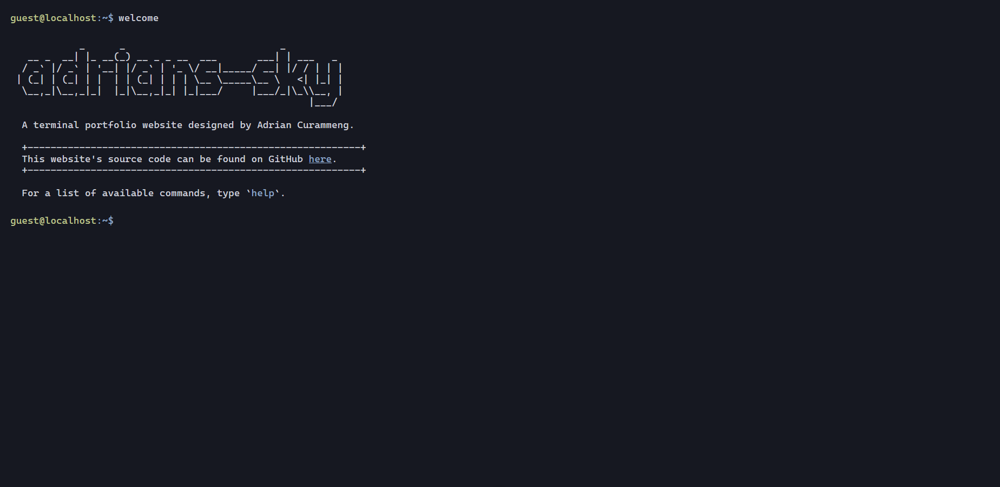

# adrians-sky-terminal-portfolio

<div align="center">



A terminal-styled portfolio website.

</div>

# Tech Stack

**Frontend Framework**: Vue 3

**Build Backend**: Vite

**Language**: JavaScript

**Styling**: CSS

**Node Version**: v.24.20.0

# Getting Started

## Prerequisites

- Node.js v24.20.0 or newer
- npm

## Intall dependencies

```sh
npm install
```

## Run in development mode

```sh
npm run dev
```

## Lint code

```sh
npm run lint
```

# Building for Production

```sh
npm run build
```

## Preview the production build

```sh
npm run preview
```

# License

This project is licensed under the MIT License. See the [LICENSE](./LICENSE) file for details.

# Credits

This project is heavily inspired by m4tt72's [terminal](https://github.com/m4tt72/terminal) and 
satnaing's [terminal-portfolio](https://github.com/satnaing/terminal-portfolio) repositories.
